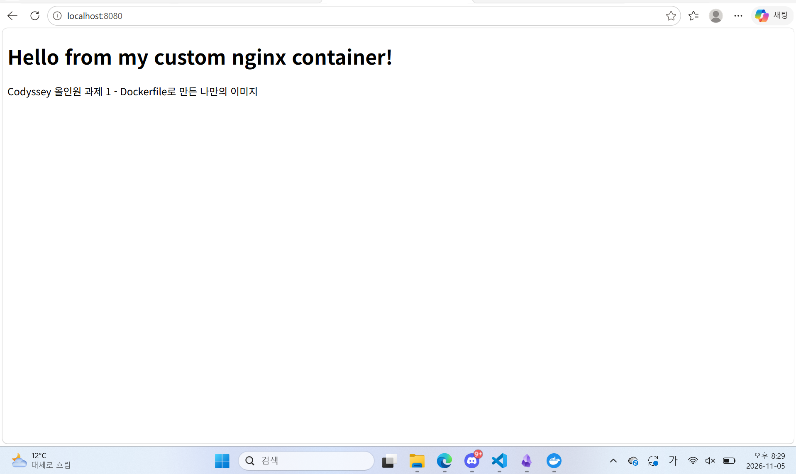
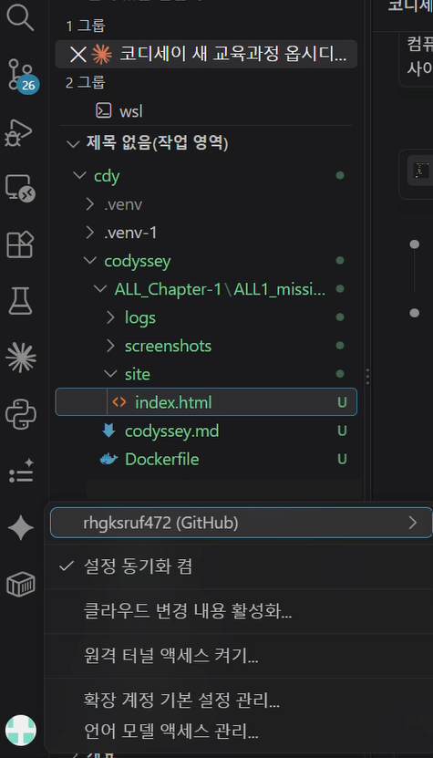
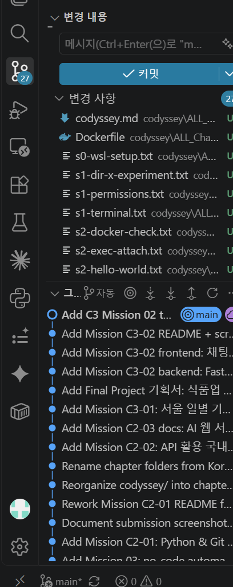

# 🛠️ 올인원 과제 1 — 내 컴퓨터에 개발자용 '작업실' 꾸미기

리눅스 터미널, Docker, Git/GitHub를 직접 손으로 세팅하고, 실행 결과(로그·접속·데이터 유지)로 검증한 개발 워크스테이션 구축 기록입니다.

| 항목 | 내용 |
|---|---|
| 제출 저장소 | [github.com/rhgksruf472/cdy-mission](https://github.com/rhgksruf472/cdy-mission) (이 폴더: `codyssey/ALL_Chapter-1/ALL1_mission-01/`) |
| 실행 환경 | Windows 11 Home + WSL2 Ubuntu 26.04.1 LTS (bash) + Docker Desktop 4.78.0 |
| Docker / Git | Docker 29.5.3 / Git 2.53.0 |
| 커스텀 이미지 | `my-web:1.0` (`nginx:alpine` 기반, 내 웹페이지 교체) — [Dockerfile](Dockerfile), [site/index.html](site/index.html) |
| 트러블슈팅 | 2건 + 참고 1건 ([바로가기](#8-트러블슈팅)) |
| 증거 | 로그 [`logs/`](logs/) 17개, 스크린샷 [`screenshots/`](screenshots/) 4개 |
| 보너스 | 이번 제출에는 포함하지 않음 ([안내](#11-보너스-과제)) |

## 프로젝트 개요

**미션 목표**: 개발은 코드를 쓰는 순간이 아니라 환경을 세팅하는 순간부터 시작됩니다. 이 과제에서는 리눅스 터미널(CLI), Docker(컨테이너), Git/GitHub(버전 관리·협업)를 직접 손으로 세팅하고, 따라 치는 데서 끝나지 않고 **실행 결과(로그·접속·데이터 유지)로 동작을 검증**했습니다.

**수행 흐름**
1. 터미널로 작업 폴더를 만들고 파일 권한을 바꿔 보며 정리했습니다.
2. Docker 설치·데몬을 점검하고, 이미지/컨테이너를 실행·관리(`images`, `ps`, `logs`, `stats`, `stop`)했습니다.
3. `nginx:alpine` 기반 웹 서버를 **Dockerfile로 컨테이너화**하고, **포트 매핑**으로 브라우저 접속을 확인했습니다.
4. **바인드 마운트**로 "변경 즉시 반영"을, **볼륨**으로 "컨테이너 삭제 후 데이터 유지"를 직접 검증했습니다.
5. Git 사용자 정보·기본 브랜치를 설정하고 VS Code에서 GitHub 로그인·저장소 연동을 확인했습니다.

**핵심 아이디어**: 이미지(설계도)와 컨테이너(실행된 상자)를 분리하고, 포트·스토리지를 명시적으로 연결하면 같은 서비스를 여러 번 실행해도 같은 결과가 재현됩니다.

## 목차
1. [실행 환경](#1-실행-환경)
2. [수행 체크리스트](#2-수행-체크리스트)
3. [검증 방법과 결과 위치](#3-검증-방법과-결과-위치)
4. [터미널 조작과 권한 실습](#4-터미널-조작과-권한-실습)
5. [Docker 설치·점검·기본 운영](#5-docker-설치점검기본-운영)
6. [Dockerfile 커스텀 이미지 · 포트 매핑 · 마운트 · 볼륨](#6-dockerfile-커스텀-이미지--포트-매핑--마운트--볼륨)
7. [Git 설정과 GitHub 연동](#7-git-설정과-github-연동)
8. [트러블슈팅](#8-트러블슈팅)
9. [과제 목표 — 설명 정리](#9-과제-목표--설명-정리)
10. [재현 방법과 주의사항](#10-재현-방법과-주의사항)
11. [보너스 과제](#11-보너스-과제)
12. [보안·개인정보 점검](#12-보안개인정보-점검)
13. [저장소 구조](#13-저장소-구조)

> **표기 안내**: 아래 코드블록의 터미널 프롬프트(`pc@...:~$`)는 가독성을 위해 `$`로 줄여 적었습니다. 명령과 출력 내용은 그대로이지만 다음 정리를 했습니다. (1) `(…생략…)`으로 표시한 부분은 안내 메시지 등 반복되는 긴 출력을 줄인 곳, (2) `docker ps` 계열 출력은 해당 실습과 관련된 컨테이너 줄만 발췌한 곳이 있음, (3) 해시(`Digest`, `sha256`) 줄과 입력 중 섞여 들어간 글자(예: `codk`, `docker i`)는 정리함. 줄이지 않은 원본은 각 항목의 `logs/` 파일에 있습니다.

---

## 1. 실행 환경

| 항목 | 값 | 근거 |
|---|---|---|
| 호스트 OS | Windows 11 Home | — |
| 리눅스 | Ubuntu 26.04.1 LTS (WSL2) | [`logs/s0-wsl-setup.txt`](logs/s0-wsl-setup.txt) |
| 쉘 / 터미널 | `/bin/bash` (WSL Ubuntu 터미널) | [`logs/s0-wsl-setup.txt`](logs/s0-wsl-setup.txt) |
| Docker Client | 29.5.3 (build d1c06ef) | [`logs/ts1-docker-not-found.txt`](logs/ts1-docker-not-found.txt) |
| Docker Server | Docker Desktop 4.78.0, Engine 29.5.3 | [`logs/s2-docker-check.txt`](logs/s2-docker-check.txt) |
| Git | 2.53.0 | [`logs/s5-git-config.txt`](logs/s5-git-config.txt) |
| 에디터 | VS Code (GitHub 계정 로그인) | [`screenshots/vscode-github-account.png`](screenshots/vscode-github-account.png) |

```
$ cat /etc/os-release | head -2
PRETTY_NAME="Ubuntu 26.04.1 LTS"
NAME="Ubuntu"
$ echo $SHELL
/bin/bash
```

## 2. 수행 체크리스트

- [x] 터미널 기본 조작 및 폴더 구성 (위치·목록·이동·생성·복사·이동/이름변경·삭제·내용 확인·빈 파일)
- [x] 권한 변경 실습 (파일 1개 + 디렉토리 1개, 변경 전/후 비교)
- [x] Docker 설치/점검 (`docker --version`, `docker version`, `docker info`)
- [x] Docker 기본 운영 (`images`, `ps`, `ps -a`, `logs`, `stats`, `stop`)
- [x] `hello-world` 실행
- [x] `ubuntu` 컨테이너 진입 + `exec` / `attach` 차이 관찰
- [x] Dockerfile 직접 작성 → 커스텀 이미지 빌드 → 컨테이너 실행
- [x] 포트 매핑 접속 (연결 없음 vs `-p 8080:80` 비교, 브라우저 + curl)
- [x] 바인드 마운트 반영 (변경 전/후 비교)
- [x] 볼륨 영속성 (컨테이너 삭제 전/후 비교)
- [x] Git 설정 (`user.name`, `user.email`, 기본 브랜치 `main`) + `git config --list` 기록
- [x] VS Code에서 GitHub 로그인 및 저장소 연동 증거
- [x] 트러블슈팅 2건 이상 기록
- [ ] 보너스 (Docker Compose, 환경 변수, SSH 키) — 미진행

## 3. 검증 방법과 결과 위치

| 수행 항목 | 검증 명령 | 확인한 것 | 결과 위치 |
|---|---|---|---|
| 터미널 조작 | `pwd`, `ls -la`, `mkdir`, `touch`, `echo >`, `cat`, `cp`, `mv`, `rm` | 폴더/파일이 의도대로 생기고 이동·삭제됨 | [`logs/s1-terminal.txt`](logs/s1-terminal.txt) |
| 권한 변경 | `ls -l`, `chmod 755`, `./hello.sh`, `ls -ld`, `chmod 700/644/755`, `cd` | 권한이 바뀌면 실행·진입 가능 여부가 달라짐 | [`logs/s1-permissions.txt`](logs/s1-permissions.txt), [`logs/s1-dir-x-experiment.txt`](logs/s1-dir-x-experiment.txt) |
| Docker 설치·데몬 | `docker --version`, `docker version`, `docker info` | Client와 Server 블록이 모두 출력됨 = 데몬 동작 중 | [`logs/s2-docker-check.txt`](logs/s2-docker-check.txt) |
| hello-world | `docker run hello-world`, `docker images`, `docker ps -a` | `Hello from Docker!`, 이미지 1개, 컨테이너 `Exited (0)` | [`logs/s2-hello-world.txt`](logs/s2-hello-world.txt) |
| ubuntu 컨테이너 | `docker run -it ubuntu bash` → `ls`, `echo` → `exit` | 컨테이너 안에서 명령 실행, `exit` 후 `Exited` | [`logs/s2-ubuntu-run.txt`](logs/s2-ubuntu-run.txt) |
| exec vs attach | `docker run -dit`, `docker exec -it`, `docker attach` | exec 뒤에는 `Up`, attach 뒤에는 `Exited` | [`logs/s2-exec-attach.txt`](logs/s2-exec-attach.txt) |
| 로그·자원·중지 | `docker logs`, `docker stats --no-stream`, `docker stop` | 컨테이너 출력 조회, CPU/메모리 확인, 중지 후 `ps -a`에만 보임 | [`logs/s2-logs-stats-stop.txt`](logs/s2-logs-stats-stop.txt) |
| 이미지 빌드 | `docker build -t my-web:1.0 .`, `docker images` | `FINISHED`, `my-web:1.0` 생성 | [`logs/s3-build-run.txt`](logs/s3-build-run.txt) |
| 포트 매핑 | `docker run -p 8080:80`, `curl`, `docker ps`, 브라우저 | `-p` 없으면 접속 실패, 있으면 내 페이지 출력 | [`logs/s3-port-mapping.txt`](logs/s3-port-mapping.txt), [`screenshots/port-8080-browser.png`](screenshots/port-8080-browser.png) |
| 바인드 마운트 | `docker run -v`, `curl`(변경 전/후), `docker inspect` | 마운트 컨테이너만 즉시 반영 | [`logs/s4-bind-mount.txt`](logs/s4-bind-mount.txt) (첫 시도 [`s4-bind-mount-partial.txt`](logs/s4-bind-mount-partial.txt)) |
| 볼륨 영속성 | `docker volume create`, `docker rm -f`, `docker exec cat` | 볼륨 안 파일은 유지, 볼륨 밖 파일은 소멸 | [`logs/s4-volume.txt`](logs/s4-volume.txt) |
| Git 설정 | `git config --global --list` | 이름·이메일·기본 브랜치 설정됨 | [`logs/s5-git-config.txt`](logs/s5-git-config.txt) |
| GitHub 연동 | VS Code 계정 메뉴, 소스 제어 화면 | GitHub 로그인 계정, `main` 브랜치와 원격 표시 | [`screenshots/vscode-github-account.png`](screenshots/vscode-github-account.png), [`screenshots/vscode-source-control.png`](screenshots/vscode-source-control.png) |

---

## 4. 터미널 조작과 권한 실습

### 4-1. 터미널 조작 (실습 위치: 리눅스 홈 `~/codyssey/practice`)

`/mnt/c`(윈도우 드라이브)는 리눅스 권한이 제대로 동작하지 않아, 실습은 리눅스 홈 디렉토리에서 진행했습니다.

```
$ cd ~
$ pwd
/home/pc
$ ls -la
total 28
drwxr-x--- 4 pc   pc   4096 Nov  5 19:11 .
drwxr-xr-x 3 root root 4096 Nov  5 19:10 ..
-rw-r--r-- 1 pc   pc    220 Nov  5 19:10 .bash_logout
-rw-r--r-- 1 pc   pc   3771 Nov  5 19:10 .bashrc
drwxr-x--- 4 pc   pc   4096 Nov  5 19:11 .cache
drwxr-x--- 3 pc   pc   4096 Nov  5 19:11 .config
-rw-rw-r-- 1 pc   pc      0 Nov  5 19:11 .motd_shown
-rw-r--r-- 1 pc   pc    807 Nov  5 19:10 .profile
$ mkdir -p codyssey/practice
$ cd codyssey/practice
$ pwd
/home/pc/codyssey/practice
$ touch empty.txt
$ echo "hello codyssey" > memo.txt
$ cat memo.txt
hello codyssey
$ ls -la
total 12
drwxr-xr-x 2 pc pc 4096 Nov  5 19:15 .
drwxr-xr-x 3 pc pc 4096 Nov  5 19:14 ..
-rw-r--r-- 1 pc pc    0 Nov  5 19:15 empty.txt
-rw-r--r-- 1 pc pc   15 Nov  5 19:15 memo.txt
$ cp memo.txt memo-copy.txt
$ mkdir backup
$ mv memo-copy.txt backup/
$ mv backup/memo-copy.txt backup/memo-renamed.txt
$ ls -la backup
total 12
drwxr-xr-x 2 pc pc 4096 Nov  5 19:16 .
drwxr-xr-x 3 pc pc 4096 Nov  5 19:16 ..
-rw-r--r-- 1 pc pc   15 Nov  5 19:15 memo-renamed.txt
$ rm backup/memo-renamed.txt
$ ls -la backup
total 8
drwxr-xr-x 2 pc pc 4096 Nov  5 19:16 .
drwxr-xr-x 3 pc pc 4096 Nov  5 19:16 ..
$ cd ..
$ pwd
/home/pc/codyssey
```

| 요구 작업 | 사용한 명령 |
|---|---|
| 현재 위치 확인 | `pwd` |
| 목록 확인(숨김 파일 포함) | `ls -la` |
| 이동 | `cd` |
| 생성 | `mkdir -p`, `touch`, `echo > 파일` |
| 복사 | `cp` |
| 이동 / 이름 변경 | `mv` (같은 명령으로 둘 다 수행) |
| 삭제 | `rm` |
| 파일 내용 확인 / 빈 파일 생성 | `cat` / `touch` |

**상대 경로가 위치에 따라 달라지는 것을 직접 확인한 로그** ([`logs/s1-terminal.txt`](logs/s1-terminal.txt) 하단):

```
$ cd ~/codyssey
$ cat memo.txt
cat: memo.txt: No such file or directory
$ cat practice/memo.txt
hello codyssey
```

### 4-2. 권한 실습

**실험 1 — 파일 `hello.sh` (644 → 755): 실행 권한 `x`의 효과**

```
$ cd ~/codyssey/practice
$ echo 'echo "hi from script"' > hello.sh
$ ls -l hello.sh
-rw-r--r-- 1 pc pc 22 Nov  5 19:27 hello.sh
$ ./hello.sh
bash: ./hello.sh: Permission denied
$ chmod 755 hello.sh
$ ls -l hello.sh
-rwxr-xr-x 1 pc pc 22 Nov  5 19:27 hello.sh
$ ./hello.sh
hi from script
```

**실험 2 — 디렉토리 `backup` (755 → 700 → 644 → 755): 디렉토리에서 `x`의 효과**

```
$ ls -ld backup
drwxr-xr-x 2 pc pc 4096 Nov  5 19:16 backup
$ chmod 700 backup
$ ls -ld backup
drwx------ 2 pc pc 4096 Nov  5 19:16 backup
$ chmod 644 backup
$ ls -ld backup
drw-r--r-- 2 pc pc 4096 Nov  5 19:16 backup
$ cd backup
bash: cd: backup: Permission denied
$ chmod 755 backup
$ ls -ld backup
drwxr-xr-x 2 pc pc 4096 Nov  5 19:16 backup
```

**보충 실험 — 디렉토리에 `r`만 있고 `x`가 없을 때** ([`logs/s1-dir-x-experiment.txt`](logs/s1-dir-x-experiment.txt)):

```
$ touch backup/a.txt
$ chmod 644 backup
$ ls backup
a.txt
$ cd backup
bash: cd: backup: Permission denied
```

→ `r`이 있으니 목록(`ls`)은 보이지만, `x`가 없으니 안으로 들어가는 `cd`는 막힙니다.

---

## 5. Docker 설치·점검·기본 운영

### 5-1. 버전과 데몬 확인

```
$ docker --version
Docker version 29.5.3, build d1c06ef
$ docker version        # (일부 발췌: Client / Server 블록)
Client:
 Version:           29.5.3
 (…생략…)
Server: Docker Desktop 4.78.0 (229452)
 Engine:
  Version:          29.5.3
  (…생략…)
$ docker info | grep -E "Server Version|Containers|Images|Operating System"
 Containers: 0
 Images: 0
 Server Version: 29.5.3
 Operating System: Docker Desktop
```

`docker version`에 **Server 블록이 나왔다 = 데몬(엔진)이 동작 중**이라는 점검 결과입니다. 전체 출력은 [`logs/s2-docker-check.txt`](logs/s2-docker-check.txt)에 있습니다.

### 5-2. hello-world와 이미지/컨테이너 목록

```
$ docker run hello-world
Unable to find image 'hello-world:latest' locally
latest: Pulling from library/hello-world
4f55086f7dd0: Pull complete 
d5e71e642bf5: Download complete 
Status: Downloaded newer image for hello-world:latest

Hello from Docker!
This message shows that your installation appears to be working correctly.
(…생략…)
$ docker images
IMAGE                ID             DISK USAGE   CONTENT SIZE   EXTRA
hello-world:latest   c567b231f656       25.9kB         9.49kB    U   
$ docker ps
CONTAINER ID   IMAGE     COMMAND   CREATED   STATUS    PORTS     NAMES
$ docker ps -a
CONTAINER ID   IMAGE         COMMAND    CREATED          STATUS                      PORTS     NAMES
1114b566f875   hello-world   "/hello"   17 seconds ago   Exited (0) 16 seconds ago             jolly_khayyam
```

같은 이미지로 한 번 더 실행하면 **이미지는 1개 그대로, 컨테이너만 2개**가 되고, 두 번째 실행에는 내려받는(Pull) 과정이 나오지 않았습니다 ([`logs/s2-hello-world.txt`](logs/s2-hello-world.txt) 하단).

### 5-3. ubuntu 컨테이너 진입

```
$ docker run -it --name my-ubuntu ubuntu bash
(…이미지 내려받기 생략…)
root@c1c4329eab6d:/# cat /etc/os-release | head -2
PRETTY_NAME="Ubuntu 26.04.1 LTS"
NAME="Ubuntu"
root@c1c4329eab6d:/# ls
bin   dev  home  lib64  mnt  proc  run   srv  tmp  var
boot  etc  lib   media  opt  root  sbin  sys  usr
root@c1c4329eab6d:/# echo "hello from container"
hello from container
root@c1c4329eab6d:/# exit
$ docker ps
CONTAINER ID   IMAGE     COMMAND   CREATED   STATUS    PORTS     NAMES
$ docker ps -a
CONTAINER ID   IMAGE         COMMAND    CREATED              STATUS                      PORTS     NAMES
c1c4329eab6d   ubuntu        "bash"     About a minute ago   Exited (0) 19 seconds ago             my-ubuntu
```

`exit`으로 `bash`를 끝내면 컨테이너도 함께 `Exited`가 됩니다.

### 5-4. 컨테이너 종료/유지 관찰: `exec` vs `attach`

```
$ docker run -dit --name my-ubuntu2 ubuntu bash
$ docker ps
47cb6213e644   ubuntu    "bash"    6 seconds ago   Up 6 seconds             my-ubuntu2
$ docker exec -it my-ubuntu2 bash
root@47cb6213e644:/# exit
$ docker ps
47cb6213e644   ubuntu    "bash"    30 seconds ago   Up 30 seconds             my-ubuntu2
$ docker attach my-ubuntu2
root@47cb6213e644:/# exit
$ docker ps -a
47cb6213e644   ubuntu        "bash"     55 seconds ago   Exited (0) 4 seconds ago              my-ubuntu2
```

| 방법 | 하는 일 | `exit` 후 컨테이너 |
|---|---|---|
| `docker exec -it … bash` | 컨테이너 안에 **새 bash를 하나 더** 엶 | **계속 실행 중** (`Up`) |
| `docker attach …` | 컨테이너가 **원래 돌리던 bash**에 연결 | **종료** (`Exited`) |

> 직접 정리한 비유: 컨테이너는 "가게", 처음에 실행한 bash는 "사장님"입니다. `exec`는 **손님이 한 명 더 들어왔다 나가는 것**이라 가게는 그대로 영업하고, `attach`는 **사장님 자리에 앉았다가 퇴근하는 것**이라 가게가 문을 닫습니다. 실행 중인 컨테이너를 점검할 때는 `exec`가 안전합니다.

### 5-5. 로그 · 자원 · 중지

```
$ docker run -d --name my-logger ubuntu bash -c 'while true; do echo "tick $(date +%T)"; sleep 2; done'
$ docker logs my-logger
tick 11:14:34
tick 11:14:36
tick 11:14:38
tick 11:14:40
tick 11:14:42
tick 11:14:44
tick 11:14:46
tick 11:14:48
tick 11:14:50
tick 11:14:52
$ docker stats --no-stream
CONTAINER ID   NAME        CPU %     MEM USAGE / LIMIT     MEM %     NET I/O         BLOCK I/O     PIDS
44c4994a0c6d   my-logger   0.00%     3.832MiB / 7.622GiB   0.05%     1.17kB / 126B   28.7kB / 0B   2
$ docker stop my-logger
$ docker ps -a
44c4994a0c6d   ubuntu        "bash -c 'while true…"   About a minute ago   Exited (137) 6 seconds ago             my-logger
```

`stop` 뒤 종료 코드가 정상 종료(0)가 아닌 **137**로 나왔습니다. 반복문을 돌리던 프로세스가 종료 요청에 바로 응하지 않아 강제 종료된 것으로 **추정**합니다(이번 출력만으로 원인을 확정하지는 못했습니다).

---

## 6. Dockerfile 커스텀 이미지 · 포트 매핑 · 마운트 · 볼륨

### 6-1. 선택한 방식과 커스텀 포인트

**선택: (A) 웹 서버 베이스 이미지 활용** — `nginx:alpine` + 정적 콘텐츠 교체. 기존 이미지(베이스)에 내 웹페이지를 얹어 새 이미지 `my-web:1.0`을 만들었습니다.

```dockerfile
# 베이스 이미지: 웹 서버(nginx)가 이미 들어 있는 가벼운 버전(alpine)을 가져온다
FROM nginx:alpine

# 이미지에 이름표(메타데이터)를 붙인다 (이미지 안의 동작은 안 바뀜)
LABEL org.opencontainers.image.title="my-custom-nginx"

# 환경 변수 하나를 추가한다 (컨테이너 안에서 APP_ENV=dev 로 보임)
ENV APP_ENV=dev

# 내 컴퓨터의 site/ 폴더 파일을 nginx가 웹페이지를 찾는 위치로 복사한다 (기본 페이지를 내 것으로 교체)
COPY site/ /usr/share/nginx/html/
```

| 커스텀 포인트 | 목적 |
|---|---|
| `FROM nginx:alpine` (베이스 선택) | 웹 서버가 이미 설치된 가벼운 기존 이미지를 출발점으로 삼아 서버를 직접 설치하지 않음 |
| `COPY site/ /usr/share/nginx/html/` | nginx 기본 안내 페이지를 내 `site/index.html`로 교체 |
| `ENV APP_ENV=dev` | 컨테이너 실행 환경(dev)을 환경 변수로 표시 |
| `LABEL … title` | 이미지에 이름표(메타데이터)를 붙여 용도를 식별 |

### 6-2. 빌드와 실행 결과

```
$ docker build -t my-web:1.0 .
[+] Building 7.9s (7/7) FINISHED docker:
 => [1/2] FROM docker.io/library/  3.7s
 => [2/2] COPY site/ /usr/share/n  0.1s
 (…생략… 전체는 logs/s3-build-run.txt)
$ docker images
IMAGE          ID             DISK USAGE
hello-world:latest  c567b231f656  25.9kB
my-web:1.0     7b3c1a2667ca       93.6MB
ubuntu:latest  6a06111c3b0a       163MB
```

> ※ `docker images`는 위 3줄만 발췌·정리해 표기했습니다(원본은 표 칸이 줄바꿈되어 출력됨).

### 6-3. 포트 매핑 접속 증거

컨테이너는 호스트와 네트워크가 격리되어 있어, 컨테이너 안의 80번 포트는 `-p 내PC포트:컨테이너포트`로 연결해야 내 PC에서 접속됩니다.

```
$ docker run -d --name my-web-nomap my-web:1.0
$ curl http://localhost:8080
curl: (7) Failed to connect to localhost port 8080 after 6 ms: Could not connect to server
$ docker run -d -p 8080:80 --name my-web-8080 my-web:1.0
$ curl http://localhost:8080
<!DOCTYPE html>
<html lang="ko">
(…생략…)
  <h1>Hello from my custom nginx container!</h1>
  <p>Codyssey 올인원 과제 1 - Dockerfile로 만든 나만의 이미지</p>
(…생략…)
$ docker ps
CONTAINER ID   IMAGE        COMMAND                  CREATED          STATUS          PORTS                                     NAMES
375202e7a208   my-web:1.0   "/docker-entrypoint.…"   20 seconds ago   Up 19 seconds   0.0.0.0:8080->80/tcp, [::]:8080->80/tcp   my-web-8080
44f4522112c6   my-web:1.0   "/docker-entrypoint.…"   39 seconds ago   Up 38 seconds   80/tcp                                    my-web-nomap
```

`PORTS` 칸 비교: 연결한 컨테이너는 `0.0.0.0:8080->80/tcp`, 연결하지 않은 컨테이너는 `80/tcp`(컨테이너 안에서만 열림)입니다.

<details>
<summary>📷 브라우저 접속 화면 (주소창 <code>localhost:8080</code> + 응답 화면)</summary>



> 이 화면은 바인드 마운트 실험으로 `<h1>`을 바꾸기 **전**의 `index.html`로 캡처했습니다.

</details>

### 6-4. 바인드 마운트: 호스트 변경 전/후 비교

같은 이미지 `my-web:1.0`으로 두 컨테이너를 띄웠습니다. **8080은 빌드 때 `COPY`로 넣은 사본**, **8081은 `-v`로 내 `site/` 폴더를 연결한 바인드 마운트**입니다.

```
$ docker run -d -p 8081:80 --name my-web-bind -v "$(pwd)/site":/usr/share/nginx/html my-web:1.0
```
(위 실행 명령 줄은 터미널 출력에는 남지 않아, 아래 `docker ps`·`docker inspect`로 같은 구성을 확인했습니다.)

```
# [변경 전] site/index.html 의 <h1>
$ curl http://localhost:8081      →  <h1>Hello from my custom nginx container!</h1>
$ curl http://localhost:8080      →  <h1>Hello from my custom nginx container!</h1>

# (VS Code에서 site/index.html 의 <h1> 을 "Bind mount works" 로 수정하고 저장)

# [변경 후]
$ curl http://localhost:8081      →  <h1>Bind mount works</h1>                           ← 즉시 반영
$ curl http://localhost:8080      →  <h1>Hello from my custom nginx container!</h1>      ← 그대로
```
(위 `curl` 결과는 출력 중 `<h1>` 줄만 발췌했습니다. 전체 HTML 출력은 [`logs/s4-bind-mount.txt`](logs/s4-bind-mount.txt).)

```
$ docker ps
b89d4226a78f   my-web:1.0   "/docker-entrypoint.…"   2 minutes ago   Up 2 minutes   0.0.0.0:8081->80/tcp, [::]:8081->80/tcp   my-web-bind
(…생략…)
$ docker inspect -f '{{ range .Mounts }}{{ .Type }} {{ .Source }} -> {{ .Destination }}{{ end }}' my-web-bind
bind /mnt/c/Users/PC/OneDrive/Desktop/vs code folder/cdy/codyssey/ALL_Chapter-1/ALL1_mission-01/site -> /usr/share/nginx/html
```

→ 내 PC의 `site` 폴더가 컨테이너의 `/usr/share/nginx/html`에 **연결(bind)**되어 있어, 내 PC에서 파일을 고치면 재빌드 없이 즉시 반영됩니다. `COPY`는 빌드 시점의 **복제본**이라 이후 변경이 반영되지 않습니다.

### 6-5. Docker 볼륨 영속성: 컨테이너 삭제 전/후 비교

같은 컨테이너 안에서 파일을 두 곳에 만들었습니다. `/data`는 볼륨 `mydata`에 연결된 곳, `/tmp`는 연결하지 않은 곳입니다.

```
$ docker volume create mydata
mydata
$ docker volume ls
DRIVER    VOLUME NAME
local     mydata
$ docker run -d --name vol-test -v mydata:/data ubuntu sleep infinity
$ docker exec -it vol-test bash -lc "echo hi > /data/hello.txt; echo bye > /tmp/lost.txt; cat /data/hello.txt /tmp/lost.txt"
hi
bye
$ docker rm -f vol-test                                     # [삭제] 컨테이너 제거
vol-test
$ docker run -d --name vol-test2 -v mydata:/data ubuntu sleep infinity   # 같은 볼륨을 새 컨테이너에 연결
$ docker exec -it vol-test2 bash -lc "cat /data/hello.txt; cat /tmp/lost.txt"
hi
cat: /tmp/lost.txt: No such file or directory
```

| 파일 | 위치 | 컨테이너 삭제 후 |
|---|---|---|
| `hello.txt` | `/data` (볼륨 연결) | **유지** (`hi`) |
| `lost.txt` | `/tmp` (볼륨 아님) | **소멸** |

---

## 7. Git 설정과 GitHub 연동

```
$ git --version
git version 2.53.0
$ git config --global --list
user.name=rhgksruf472
user.email=●●●@●●●
init.defaultbranch=main
```

(이메일은 공개 저장소를 고려해 `●●●@●●●`로 가렸습니다. 기본 브랜치 설정 이름 `init.defaultBranch`는 Git이 대소문자를 구분하지 않아 소문자로 표시됩니다.)

저장소 설정에는 GitHub 원격이 연결되어 있습니다 (`git config --list` 중):

```
remote.origin.url=https://github.com/rhgksruf472/cdy-mission.git
branch.main.remote=origin
branch.main.merge=refs/heads/main
```

<details>
<summary>📷 VS Code GitHub 로그인 (계정 메뉴)</summary>



</details>

<details>
<summary>📷 VS Code 소스 제어 (저장소·브랜치 연동)</summary>



</details>

---

## 8. 트러블슈팅

### 트러블슈팅 1 — WSL Ubuntu에서 `docker` 명령을 찾지 못함

| 단계 | 내용 |
|---|---|
| **문제** | Ubuntu 터미널에서 `docker --version` → `The command 'docker' could not be found in this WSL 2 distro.` |
| **원인 가설** | Docker Desktop은 윈도우에 설치돼 있지만, 새로 설치한 Ubuntu에는 연결하는 **WSL integration**이 꺼져 있을 것이다 (에러 메시지도 WSL integration 활성화를 권장) |
| **확인** | 같은 명령을 **윈도우 PowerShell**에서 실행하면 `Docker version 29.5.3`이 정상 출력됨 → Docker는 설치돼 있고 Ubuntu 쪽 연결만 빠진 것으로 판단 |
| **해결** | Docker Desktop → Settings → Resources → **WSL integration**의 Ubuntu 스위치를 껐다 켠 뒤 Ubuntu 터미널을 새로 열어 `docker --version` 실행 → `Docker version 29.5.3` 출력 |
| **비고** | 스위치의 **원래 상태는 확인하지 못했습니다**(껐다 켠 뒤 해결). 따라서 "연결 설정이 풀려 있었다"는 가설은 해결 결과로 뒷받침될 뿐 원래 상태로 직접 확인한 것은 아닙니다. |
| **증거** | [`logs/ts1-docker-not-found.txt`](logs/ts1-docker-not-found.txt), [`screenshots/ts1-docker-desktop-wsl-integration-ubuntu-on.png`](screenshots/ts1-docker-desktop-wsl-integration-ubuntu-on.png) |

### 트러블슈팅 2 — `docker build`가 `requires 1 argument`로 실패

| 단계 | 내용 |
|---|---|
| **문제** | `docker build -t my-web:1.0.` → `ERROR: docker: 'docker buildx build' requires 1 argument`, `docker images`에 `my-web`이 생기지 않음 |
| **원인 가설** | `1.0`과 마지막 `.` 사이 **공백이 빠져** `1.0.`이 이름표(`-t`) 값으로 합쳐졌고, 빌드 위치(`PATH`, 현재 폴더 `.`)가 인자로 전달되지 않았다 |
| **확인** | 에러 문구가 `PATH | URL | -` 중 하나가 필요하다고 안내함 + 이미지가 생성되지 않음 |
| **해결** | 공백을 넣어 `docker build -t my-web:1.0 .`로 재실행 → `Building 7.9s (7/7) FINISHED`, `my-web:1.0` 생성 |
| **증거** | [`logs/ts2-docker-build-missing-space.txt`](logs/ts2-docker-build-missing-space.txt), [`logs/s3-build-run.txt`](logs/s3-build-run.txt) |

### 참고 — Git 설정 이름 오타가 에러 없이 저장됨

| 단계 | 내용 |
|---|---|
| **문제** | `git config --global user.emmail …`(`email` 오타)가 에러 없이 저장되어, 전역 설정에 올바른 `user.email`이 없는 상태가 됨 |
| **확인** | `git config --list`에서 `user.emmail=…`이 보이고 전역에 `user.email`이 없음 |
| **해결** | `git config --global --unset user.emmail`(지울 때는 값이 아니라 **이름(키)**을 씀)로 삭제하고 `git config --global user.email "…"`로 다시 설정 → `--global --list`에서 오타 항목 사라짐. 중간에 `--unset`에 값(이메일)을 넣거나 `--user.email`처럼 `--`를 붙인 명령 형태 실수가 두 번 있었음(`invalid key`, `unknown option`) |
| **배운 점** | Git은 설정 이름의 철자를 검증하지 않으므로, 설정 후 `git config --list`로 반드시 확인해야 함 |
| **증거** | [`logs/s5-git-config.txt`](logs/s5-git-config.txt) |

---

## 9. 과제 목표 — 설명 정리

| 목표 | 설명 | 저장소 내 근거 |
|---|---|---|
| **절대 경로 vs 상대 경로** | 절대 경로는 `/`부터 시작하는 전체 주소라 어디서든 같은 곳을 가리킵니다 (`/home/pc/codyssey/practice/memo.txt`). 상대 경로는 **지금 서 있는 위치 기준**이라 위치에 따라 달라집니다 (`practice` 안에서는 `memo.txt`, 한 단계 위 `~/codyssey`에서는 `practice/memo.txt`, 홈에서는 `codyssey/practice/memo.txt`). | [`logs/s1-terminal.txt`](logs/s1-terminal.txt) (`~/codyssey`에서 `cat memo.txt` 실패 → `cat practice/memo.txt` 성공) |
| **파일 권한 r/w/x, 755·644** | 권한은 **주인 / 그룹 / 그 외** 3묶음이고 묶음마다 r=4, w=2, x=1을 더해 숫자 하나로 씁니다. `755` = `rwx`(7) `r-x`(5) `r-x`(5), `644` = `rw-`(6) `r--`(4) `r--`(4), `640` = `rw-` `r--` `---`. 파일의 `x`는 **실행**, 디렉토리의 `x`는 **안으로 들어가기(cd)**, 디렉토리의 `r`은 **목록 보기(ls)**입니다. | [`logs/s1-permissions.txt`](logs/s1-permissions.txt), [`logs/s1-dir-x-experiment.txt`](logs/s1-dir-x-experiment.txt) |
| **커스텀 이미지 제작** | 기존 이미지 `nginx:alpine`을 `FROM`으로 가져오고, 내 `site/` 폴더를 `COPY`로 `/usr/share/nginx/html/`에 넣어 기본 페이지를 교체한 뒤 `docker build -t my-web:1.0 .`로 새 이미지를 만들었습니다. | [`Dockerfile`](Dockerfile), [`site/index.html`](site/index.html), [`logs/s3-build-run.txt`](logs/s3-build-run.txt) |
| **포트 매핑이 필요한 이유** | 컨테이너는 호스트와 네트워크가 **격리**되어 컨테이너 안의 포트(80)가 내 PC에서 보이지 않습니다. `-p 8080:80`은 **내 PC의 8080번**을 **컨테이너의 80번**에 연결해 줍니다. `-p` 없이 실행한 컨테이너는 접속에 실패했습니다. | [`logs/s3-port-mapping.txt`](logs/s3-port-mapping.txt), [`screenshots/port-8080-browser.png`](screenshots/port-8080-browser.png) |
| **Docker 볼륨(영속 데이터)** | 컨테이너를 지우면 컨테이너 안의 파일도 사라집니다. 볼륨은 Docker가 컨테이너와 **별개로 관리하는 보관함**이라, 컨테이너 안 폴더에 연결해 두면 컨테이너를 삭제해도 데이터가 남고 새 컨테이너에 다시 연결할 수 있습니다. (바인드 마운트는 내가 고른 내 PC 폴더에 연결, 볼륨은 Docker가 관리하는 곳에 연결) | [`logs/s4-volume.txt`](logs/s4-volume.txt), [`logs/s4-bind-mount.txt`](logs/s4-bind-mount.txt) |
| **Git vs GitHub** | **Git**은 내 컴퓨터(로컬) 안에서 파일의 변경 이력을 기록·관리하는 버전관리 도구(일기장)이고, **GitHub**는 그 저장소를 인터넷(원격)에 올려 백업하고 여러 사람이 협업하게 해 주는 서비스(게시판)입니다. Git은 GitHub 없이도 쓸 수 있습니다. | [`logs/s5-git-config.txt`](logs/s5-git-config.txt), [`screenshots/vscode-source-control.png`](screenshots/vscode-source-control.png) |

---

## 10. 재현 방법과 주의사항

### 재현 순서 (이 폴더 기준)

```bash
# 0) 전제: WSL2 Ubuntu + Docker Desktop(WSL integration에서 Ubuntu 켬) 설치
# 1) 이 폴더로 이동 (경로에 공백이 있으니 따옴표 필수)
cd "<저장소 경로>/codyssey/ALL_Chapter-1/ALL1_mission-01"

# 2) 이미지 빌드 → 포트 매핑 실행 → 확인
docker build -t my-web:1.0 .
docker run -d -p 8080:80 --name my-web-8080 my-web:1.0
curl http://localhost:8080            # 또는 브라우저에서 http://localhost:8080

# 3) 바인드 마운트: site/index.html 을 고친 뒤 새로 고침하면 즉시 반영
docker run -d -p 8081:80 --name my-web-bind -v "$(pwd)/site":/usr/share/nginx/html my-web:1.0
curl http://localhost:8081

# 4) 볼륨 영속성
docker volume create mydata
docker run -d --name vol-test -v mydata:/data ubuntu sleep infinity
docker exec -it vol-test bash -lc "echo hi > /data/hello.txt"
docker rm -f vol-test
docker run -d --name vol-test2 -v mydata:/data ubuntu sleep infinity
docker exec -it vol-test2 bash -lc "cat /data/hello.txt"     # → hi

# 5) 정리(선택)
docker rm -f my-web-8080 my-web-bind vol-test2
docker volume rm mydata
```

### 개인 PC 종속 사항과 대체 방법

| 항목 | 내 환경 | 다른 환경에서는 |
|---|---|---|
| 리눅스 | Windows 11 + WSL2 Ubuntu (과제 원문의 서울캠퍼스 OrbStack 안내는 **사용하지 않음**) | 리눅스·macOS(OrbStack 포함)에서도 `docker` 명령은 동일하게 동작 |
| Docker 연결 | Docker Desktop의 **WSL integration**에서 Ubuntu를 켜야 함 (트러블슈팅 1) | 리눅스 네이티브 Docker는 불필요 |
| 폴더 경로 | `/mnt/c/Users/PC/...` (윈도우 드라이브) | 본인 저장소 경로로 대체. `/mnt/c`는 리눅스 권한이 제대로 동작하지 않아 **권한 실습은 리눅스 홈(`~`)에서** 진행 |
| 바인드 마운트 | `-v "$(pwd)/site":...` 로 현재 폴더 기준 지정 | 경로에 공백이 있으면 따옴표 필수 |

## 11. 보너스 과제

이번 제출에는 포함하지 않았습니다 (Docker Compose 단일/멀티, Compose 운영 명령, 환경 변수 활용, GitHub SSH 키).

## 12. 보안·개인정보 점검

- 이메일은 공개 저장소를 고려해 로그·README에서 `●●●@●●●`로 가렸습니다.
- 토큰, 비밀번호, 개인키, 인증 코드는 사용하지 않았고 로그·README·스크린샷에 포함되지 않았음을 문자열 검색(`password`, `token`, `secret`, `ghp_`, `github_pat`, `PRIVATE KEY`, `api key`)으로 확인했습니다.
- VS Code 스크린샷은 비공개 대상 파일명이 보이던 한 줄을 가린 사본을 사용했습니다.
- 로그의 `pc@DESKTOP-…` 프롬프트에는 컴퓨터 이름과 리눅스 사용자명이 포함되어 있습니다(민감 인증정보 아님).

## 13. 저장소 구조

```
ALL1_mission-01/
├── README.md
├── codyssey.md                  # 과제 원문
├── Dockerfile                   # nginx:alpine 기반 커스텀 이미지
├── site/
│   └── index.html               # 웹 서버 소스(정적 페이지)
├── logs/                        # 터미널/Docker/Git 원본 로그 (17개)
│   ├── s0-wsl-setup.txt
│   ├── s1-terminal.txt
│   ├── s1-permissions.txt
│   ├── s1-dir-x-experiment.txt
│   ├── s2-docker-check.txt
│   ├── s2-hello-world.txt
│   ├── s2-ubuntu-run.txt
│   ├── s2-exec-attach.txt
│   ├── s2-logs-stats-stop.txt
│   ├── s3-build-run.txt
│   ├── s3-port-mapping.txt
│   ├── s4-bind-mount.txt
│   ├── s4-bind-mount-partial.txt  # 첫 시도(변경 후만 기록) — 보존용
│   ├── s4-volume.txt
│   ├── s5-git-config.txt
│   ├── ts1-docker-not-found.txt
│   └── ts2-docker-build-missing-space.txt
└── screenshots/
    ├── port-8080-browser.png
    ├── ts1-docker-desktop-wsl-integration-ubuntu-on.png
    ├── vscode-github-account.png
    └── vscode-source-control.png
```
