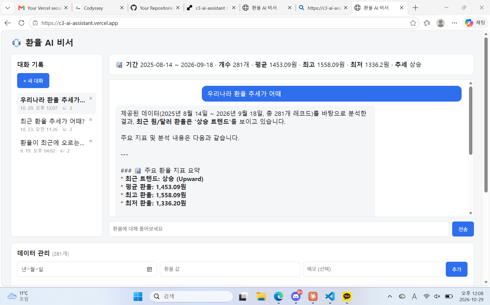
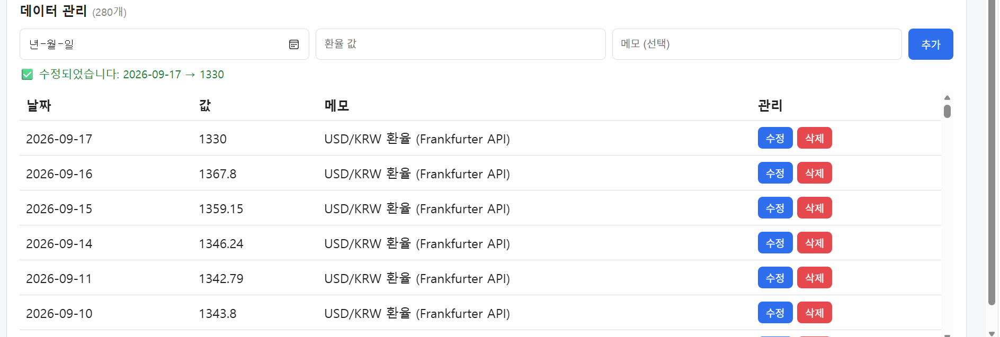
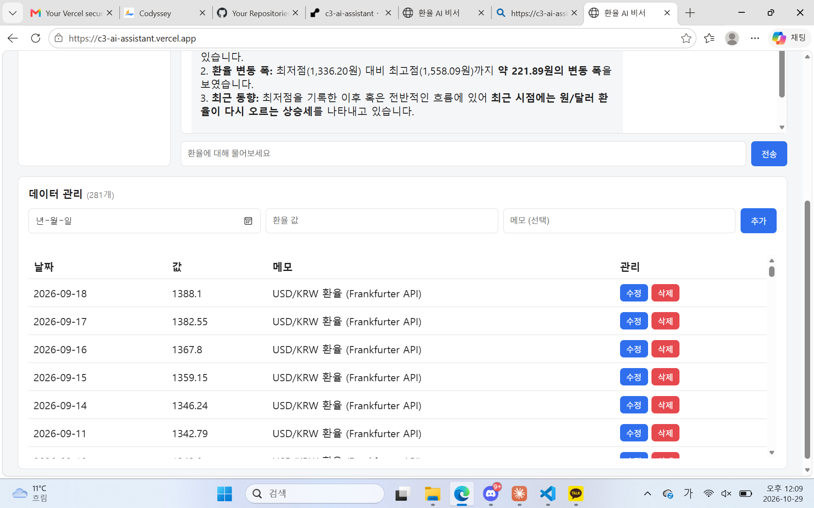
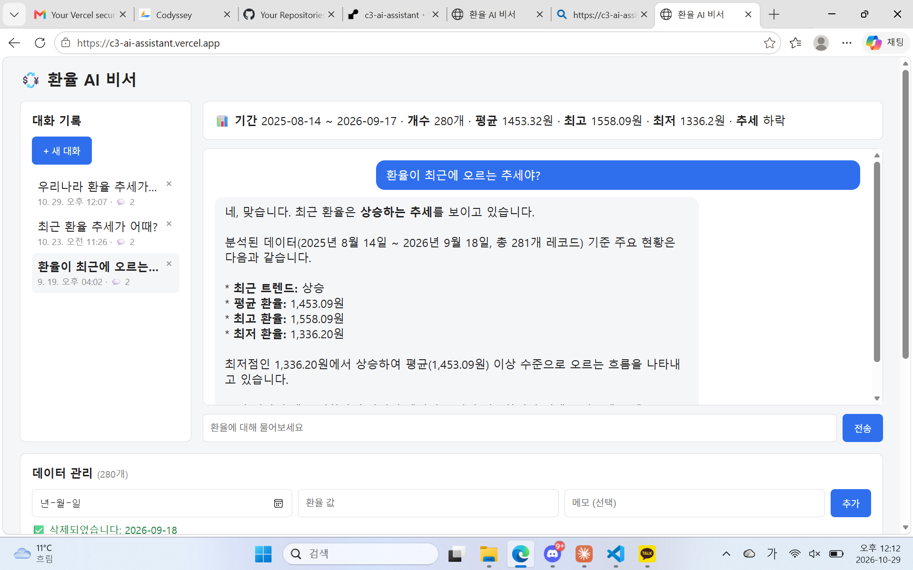

# 💱 환율 AI 비서 — 데이터 기반 AI Agent (C3 Mission 02)

USD/KRW 일별 환율 데이터를 분석해 요약 정보를 만들고, 이 요약을 AI(Gemini)에게 "컨텍스트"로 주입해 내 데이터를 아는 채팅 비서를 만든 풀스택 웹 서비스입니다.

| 항목 | 내용 |
|---|---|
| 배포 사이트(프론트엔드) | [c3-ai-assistant.vercel.app](https://c3-ai-assistant.vercel.app) |
| 배포 API(백엔드) | [c3-ai-assistant.onrender.com](https://c3-ai-assistant.onrender.com) |
| API 문서(Swagger) | [c3-ai-assistant.onrender.com/docs](https://c3-ai-assistant.onrender.com/docs) |
| 데이터 주제 | USD/KRW 일별 환율, 281개 레코드 (2025-08-14 ~ 2026-09-18) |
| 백엔드 | FastAPI 0.141.1 + Firestore + Gemini API |
| 프론트엔드 | HTML / CSS / JavaScript (프레임워크 없음) |

> ⚠️ **AI 모델 대체 안내**: 과제 원문은 OpenAI(GPT) API 사용을 명시하지만, 비용 부담으로 **Google Gemini API**로 대체했습니다. 데이터 요약을 시스템 프롬프트에 주입해 AI가 답변하는 핵심 구조(컨텍스트 주입)는 동일하게 구현했습니다.

## 목차
- [무엇을 해결하는 서비스인가](#무엇을-해결하는-서비스인가)
- [기술 스택](#기술-스택)
- [기능 데모 (스크린샷)](#기능-데모-스크린샷)
- [API 엔드포인트](#api-엔드포인트)
- [로컬 실행 방법](#로컬-실행-방법)
- [환경 변수](#환경-변수)
- [과제 목표 ↔ 근거 대응표](#과제-목표--근거-대응표)
- [트러블슈팅 기록](#트러블슈팅-기록)
- [저장소 구조](#저장소-구조)

## 무엇을 해결하는 서비스인가

환율 같은 시계열 데이터를 그냥 숫자 나열로만 보면 추세를 파악하기 어렵습니다. 이 서비스는 (1) 데이터를 요약 정보(기간·개수·평균/최고/최저·추세)로 가공하고, (2) 그 요약을 AI에게 "배경지식"으로 주고 자연어로 질문하면 데이터에 기반한 답변을 받을 수 있게 하며, (3) 그 대화를 저장해뒀다가 다시 불러볼 수 있게 합니다.

## 기술 스택

| 영역 | 사용 기술 |
|---|---|
| 백엔드 프레임워크 | FastAPI 0.141.1, Uvicorn 0.53.0 |
| 데이터베이스 | Firebase Firestore (firebase-admin 7.6.0) |
| AI | Google Gemini API (google-genai 2.24.0, 모델 `gemini-3.6-flash`) |
| 프론트엔드 | 바닐라 HTML / CSS / JavaScript |
| 백엔드 배포 | Render (Free Instance) |
| 프론트엔드 배포 | Vercel |
| 데이터 출처 | [Frankfurter](https://www.frankfurter.app/) 공개 환율 API |

## 기능 데모 (스크린샷)

<details>
<summary>1. 데이터 요약이 반영된 AI 채팅</summary>

상단에 데이터 요약(기간/개수/평균/최고/최저/추세)이 표시되고, 그 아래 채팅에서 "우리나라 환율 추세가 어때"라고 물으면 Gemini가 실제 평균(1,453.09원) 등 요약 수치를 그대로 인용해 답합니다.


</details>

<details>
<summary>2. 데이터 관리 — 수정 동작</summary>

목록의 "수정" 버튼으로 값을 바꾸면 즉시 Firestore에 반영되고 "수정되었습니다" 결과 문구가 표시됩니다. (아래는 트러블슈팅 중 캡처한 실제 수정 화면이며, 데이터는 작업 직후 원본 값으로 복구했습니다.)



전체 목록(281개, 최신순):


</details>

<details>
<summary>3. 대화 기록 불러오기</summary>

왼쪽 사이드바에서 과거 대화를 클릭하면 그 대화의 질문·답변이 오른쪽에 그대로 다시 표시됩니다.


</details>

## API 엔드포인트

| 메서드 | 경로 | 설명 |
|---|---|---|
| GET | `/` | 헬스체크 |
| POST | `/api/data` | 데이터 추가 |
| GET | `/api/data` | 데이터 목록 조회 |
| PUT | `/api/data/{id}` | 데이터 수정 |
| DELETE | `/api/data/{id}` | 데이터 삭제 |
| GET | `/api/data/summary` | 데이터 요약(기간/개수/평균·최고·최저/추세) |
| POST | `/api/conversations` | 대화 저장 |
| GET | `/api/conversations` | 대화 목록 조회(제목/생성일/메시지 수) |
| GET | `/api/conversations/{id}` | 특정 대화 상세 조회(전체 메시지) |
| DELETE | `/api/conversations/{id}` | 대화 삭제 |
| POST | `/api/chat` | AI 채팅 (데이터 요약 → 시스템 프롬프트 주입 → Gemini 호출 → 대화 자동 저장) |

전체 스펙은 [Swagger UI](https://c3-ai-assistant.onrender.com/docs)에서 직접 확인할 수 있습니다.

## 로컬 실행 방법

```bash
# 1. backend 폴더로 이동 후 가상환경 생성 및 활성화
cd backend
python -m venv venv
venv\Scripts\activate        # Windows
# source venv/bin/activate   # macOS/Linux

# 2. 패키지 설치
python -m pip install -r requirements.txt

# 3. .env 파일 생성 후 아래 "환경 변수" 값 채우기

# 4. 서버 실행
python -m uvicorn main:app --reload
```

실행 후 `http://localhost:8000/docs`에서 Swagger UI 확인 가능합니다.

프론트엔드는 `frontend/` 폴더의 `index.html`을 브라우저로 열거나, `config.js`의 `API_BASE_URL`을 로컬 주소로 바꾼 뒤 간단한 정적 서버로 실행하면 됩니다.

## 환경 변수

| 변수명 | 설명 |
|---|---|
| `GEMINI_API_KEY` | Google Gemini API 키 |
| `FIREBASE_SERVICE_ACCOUNT_PATH` | Firebase 서비스 계정 키(JSON) 파일 경로 |
| `ALLOWED_ORIGINS` | CORS 허용 출처(쉼표로 여러 개 구분, 프론트엔드 배포 주소) |
| `API_BASE_URL` | (프론트엔드 Vercel 빌드용) 백엔드 API 주소 — Build Command가 이 값으로 `config.js`를 생성 |

> 서비스 계정 키(`firebase-key.json`)와 `.env`는 저장소에 포함하지 않았습니다(`.gitignore` 처리). Render에는 Secret File 기능으로 키 파일을 별도 전달했습니다.

## 과제 목표 ↔ 근거 대응표

| 과제 목표 | 저장소 내 근거 |
|---|---|
| 시계열 데이터 분석 → 요약 정보 → 서비스 활용 흐름 | [`data/collect_fx_data.py`](data/collect_fx_data.py) (수집) → [`backend/routers/data.py`](backend/routers/data.py)의 `/api/data/summary` (요약 계산) → [`backend/routers/chat.py`](backend/routers/chat.py) (요약을 채팅에 활용) |
| FastAPI 프로젝트를 라우터/서비스로 분리한 기준 | `routers/`(HTTP 요청·응답 처리) ↔ `services/`(Firestore·Gemini 등 외부 연동 로직)로 역할 분리 — [`backend/routers/`](backend/routers/), [`backend/services/`](backend/services/) |
| Pydantic 요청 검증 | [`backend/schemas.py`](backend/schemas.py)의 `DataItem` 모델 |
| Firestore CRUD | [`backend/services/firestore_service.py`](backend/services/firestore_service.py), [`backend/routers/data.py`](backend/routers/data.py) |
| 데이터 요약의 시스템 프롬프트 주입(컨텍스트 주입) | [`backend/services/gemini_service.py`](backend/services/gemini_service.py)의 `ask_gemini(system_prompt, user_message)` — `system_instruction`에 요약을, `contents`에 질문을 분리해서 전달 |
| 배포 환경의 CORS/환경변수/키 관리 | [`backend/main.py`](backend/main.py)의 `CORSMiddleware`(`ALLOWED_ORIGINS` 환경변수), Render Secret File(서비스 계정 키) |

## 트러블슈팅 기록

- **AI API 대체**: 원문이 요구한 OpenAI 대신 Gemini API 사용(비용 부담). `google-generativeai`가 지원 종료 경고를 띄워 최신 `google-genai` SDK로 재교체했고, 모델명도 API가 직접 안내한 `gemini-3.6-flash`로 변경했습니다.
- **Windows 스마트 앱 컨트롤**: 로컬 venv의 `pip.exe`와 `firebase-admin`이 쓰는 grpc DLL이 차단되어 `python -m pip`, `python -m uvicorn` 형태로 실행 방식을 바꿔 해결했습니다.
- **requirements.txt 인코딩**: 한글 주석 때문에 Render 빌드 중 `cp949` 인코딩 에러가 나서 주석을 전부 영어(ASCII)로 바꿨습니다.
- **Vercel 배포 실패(`STATIC_BUILD_NO_OUT_DIR`)**: Build Command를 지정하면 Vercel이 기본으로 `public` 폴더를 찾는데 프로젝트 구조가 `public` 없이 `frontend/` 바로 아래에 파일이 있어 실패했습니다. Settings → Build and Deployment → **Output Directory**를 `.`으로 지정해 해결했습니다.
- **콜드스타트**: Render 무료 인스턴스는 비활성 상태가 길어지면 잠들며, 첫 요청이 **50초 이상** 걸릴 수 있습니다(실측: 51.4초). 프론트엔드 상단에 "서버를 깨우는 중입니다..." 안내 띠를 두어 대응했습니다.

## 저장소 구조

```
C3_mission-02/
├── codyssey.md              # 과제 원문
├── README.md                 # 이 문서
├── screenshots/               # 제출용 화면 캡처
├── data/
│   ├── collect_fx_data.py    # Frankfurter API로 환율 수집
│   └── results/usd_krw_fx_data.json   # 실측 수집 결과(281개)
├── backend/
│   ├── main.py                # FastAPI 앱 + CORS 설정
│   ├── schemas.py              # Pydantic 요청 모델
│   ├── requirements.txt
│   ├── seed_data.py            # 환율 281개 Firestore 적재 스크립트
│   ├── clear_data.py           # 컬렉션 정리 스크립트
│   ├── test_firestore_connection.py
│   ├── routers/
│   │   ├── data.py             # /api/data (CRUD + summary)
│   │   ├── conversations.py    # /api/conversations (대화 CRUD)
│   │   └── chat.py             # /api/chat (AI 채팅)
│   └── services/
│       ├── firestore_service.py
│       ├── gemini_service.py
│       └── analysis_service.py
└── frontend/
    ├── index.html
    ├── style.css
    ├── config.js                # Vercel 빌드 시 API_BASE_URL 주입
    └── app.js                   # 채팅/데이터/대화 기록 로직
```
